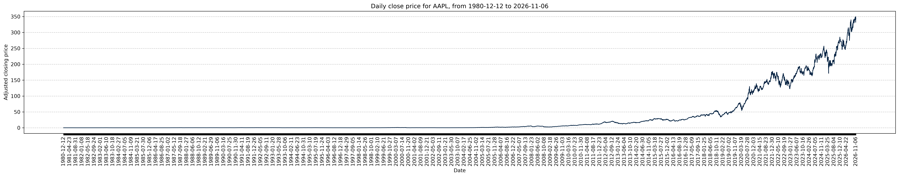

# US Stocks — Open Historical US Stock Market Data

**An open-source collection of historical US stock market data, ticker lists, and Python tools for downloading, processing, and maintaining daily stock-price datasets.**

[](https://www.python.org/)
[](https://www.nasdaq.com/market-activity/stocks/screener)
[](https://github.com/eshaanmattoo/us_stocks)
[](https://github.com/eshaanmattoo/us_stocks)

**Repository:** https://github.com/eshaanmattoo/us_stocks

## Overview

`us_stocks` is an open-source project focused on collecting, organizing, and maintaining historical daily stock-market data for publicly traded companies in the United States.

The project provides a collection of US stock ticker lists, historical market-data retrieval scripts, CSV-based data storage, and price visualization tools.

It is intended to help students, developers, researchers, quantitative analysts, and machine learning practitioners access and work with historical US equity market data.



The project is particularly relevant to:

- Historical stock market data analysis
- Financial data science and quantitative research
- Algorithmic trading research and backtesting
- Machine learning and deep learning experiments
- Stock price forecasting and time-series analysis
- Financial sentiment analysis and news-driven research
- Portfolio analysis and cross-company comparisons

## Dataset Coverage

The current company universe was assembled using the [Nasdaq Stock Screener](https://www.nasdaq.com/market-activity/stocks/screener).

### Supported stock exchanges

| Exchange | Stocks collected |
|---|---:|
| NASDAQ | 1,806 |
| New York Stock Exchange (NYSE) | 1,045 |
| NYSE American (AMEX) | Not currently included |
| **Total** | **2,851** |

These numbers represent the stocks collected for this project, not the total number of securities listed on each exchange.

The historical price retrieval scripts operate on configurable ticker lists. Historical price coverage varies by company, listing date, and data availability.

**Important:** The exchange ticker universe and the historical price dataset are two distinct things. Not every ticker in the company universe necessarily has a corresponding downloaded historical price file.

## Historical Stock Market Data

Historical daily market data is retrieved using [Yahoo Finance](https://finance.yahoo.com/) through the Python `yfinance` library.

The downloader is configured to retrieve:

- Maximum available historical data (`period="max"`)
- Daily trading data (`interval="1d"`)
- Automatically adjusted OHLC prices (`auto_adjust=True`)

### Data fields

Each individual stock dataset follows this structure:

| Column | Description |
|---|---|
| Date | Trading date |
| Open | Adjusted opening price |
| High | Adjusted highest price |
| Low | Adjusted lowest price |
| Close | Adjusted closing price |
| Volume | Daily trading volume |
| Daily_Return | Daily percentage return |

Daily percentage returns are calculated using:

\[
R_t = \frac{P_t-P_{t-1}}{P_{t-1}}\times100
\]

Where:

- \(R_t\) is the percentage return on trading day \(t\).
- \(P_t\) is the adjusted closing price on day \(t\).
- \(P_{t-1}\) is the adjusted closing price on the previous trading day.

The first return observation is left empty because no previous trading-day price exists.

### Example dataset

| Date | Open | High | Low | Close | Volume | Daily_Return |
|---|---:|---:|---:|---:|---:|---:|
| 2025-01-02 | 243.50 | 245.20 | 241.80 | 244.10 | 42,500,000 | |
| 2025-01-03 | 244.20 | 247.10 | 243.00 | 246.50 | 38,200,000 | 0.9832 |
| 2025-01-06 | 246.70 | 248.00 | 245.10 | 247.30 | 35,100,000 | 0.3245 |

*Illustrative data for documentation purposes.*

## Repository Structure

```text
us_stocks/
│
├── nasdaq/                  # NASDAQ stock universe
│
├── nyse/                    # NYSE stock universe
│
├── ticker_list/             # Stock ticker lists
│
├── project.py               # Historical stock data retrieval
│
├── retrieve_stock_data.py   # Incremental data updates
│
├── test.py                  # Testing and experiments
│
└── README.md
```

### Generated data structure

The retrieval scripts organize downloaded stock data by ticker:

```text
data/
│
├── AAPL/
│   ├── AAPL.csv
│   └── AAPL_chart.png
│
├── MSFT/
│   ├── MSFT.csv
│   └── MSFT_chart.png
│
└── NVDA/
    ├── NVDA.csv
    └── NVDA_chart.png
```

Each company has an individual CSV containing its historical daily market data and a corresponding closing-price visualization.

## Getting Started

### Requirements

- Python 3.10 or later
- Internet connection
- pip

### 1. Clone the repository

```bash
git clone https://github.com/eshaanmattoo/us_stocks.git

cd us_stocks
```

### 2. Create a virtual environment

```bash
python3 -m venv .venv

source .venv/bin/activate
```

### 3. Install dependencies

```bash
pip install yfinance pandas numpy matplotlib torch
```

### 4. Configure stock symbols

Open `project.py` and configure the stock symbols you want to retrieve.

```python
config = {
    "stock": {
        "symbols": ["AAPL", "MSFT", "NVDA"],
        "period": "max",
        "interval": "1d"
    }
}
```

You can replace these symbols with any supported Yahoo Finance ticker symbols.

### 5. Download historical stock data

```bash
python project.py
```

The script retrieves available historical daily prices, calculates daily percentage returns, saves the results as CSV files, and generates closing-price charts.

## Updating Historical Stock Data

The repository includes `retrieve_stock_data.py` for maintaining existing historical datasets.

Its functionality includes:

- Retrieving newer daily stock-market observations.
- Configurable start dates.
- Appending new observations to existing CSV files.
- Removing duplicate dates.
- Recalculating daily percentage returns.
- Regenerating historical closing-price charts.

Configure the relevant settings in the script:

```python
"start_date": "YYYY-MM-DD",
"append_to_existing": True,
"interval": "1d"
```

Execute the updater:

```bash
python retrieve_stock_data.py
```

This allows previously collected historical datasets to be extended without manually downloading the entire historical series again.

## Applications and Research Use Cases

The collected historical market data can serve as a foundation for several financial research and development applications.

### Financial Data Analysis

- Daily and annual stock returns
- Historical price movements
- Volatility estimation
- Correlation analysis
- Maximum drawdown
- Cross-company and sector comparisons

### Machine Learning and Deep Learning

- Time-series forecasting
- LSTM and recurrent neural networks
- Transformer-based forecasting
- Feature engineering
- Model evaluation and comparison

### Quantitative Finance

- Portfolio construction
- Historical backtesting
- Risk and return analysis
- Statistical market research

### Financial NLP and Sentiment Analysis

Historical price data can also be combined with external financial news datasets to investigate the relationship between company-specific news sentiment and subsequent stock returns.

Potential extensions include FinBERT-based sentiment classification, news aggregation, and sentiment-aware predictive models.

## Data Sources and Methodology

| Component | Source / Tool |
|---|---|
| Company listings | Nasdaq Stock Screener |
| Historical stock prices | Yahoo Finance |
| Data retrieval | yfinance |
| Data processing | Pandas and NumPy |
| Visualizations | Matplotlib |
| Machine learning framework | PyTorch |

### Data considerations

- Historical coverage differs across companies.
- IPO dates determine the earliest possible trading observations.
- Missing observations and trading holidays may affect individual time series.
- Automatically adjusted OHLC values should be distinguished from unadjusted exchange-reported prices.
- Yahoo Finance data availability and historical records may change.
- The current company universe should not be treated as a historical constituent universe.

For historical research, users should also consider survivorship bias, delisted companies, ticker changes, mergers, corporate actions, and look-ahead bias.

## Intended Audience

This project is designed for:

- Students learning financial data analysis.
- Researchers studying historical stock-market behaviour.
- Data scientists developing financial machine learning models.
- Developers building stock analysis and visualization applications.
- Quantitative finance practitioners conducting exploratory research.
- AI and LLM developers looking for structured historical equity data.

## Contributing

Contributions, suggestions, and improvements are welcome.

You can contribute by:

- Improving the stock universe and ticker metadata.
- Adding support for additional US exchanges.
- Improving data retrieval and validation.
- Adding historical data formats such as Parquet.
- Developing exploratory data analysis tools.
- Improving documentation and examples.

Please open an issue or submit a pull request to contribute.

## Disclaimer

This project is intended for educational, research, and software development purposes only.

Historical market data may contain inaccuracies, missing observations, or revisions. This project does not guarantee the completeness, accuracy, or uninterrupted availability of third-party financial data.

Nothing in this repository constitutes financial or investment advice.

---

**Maintained by:** [Eshaan Mattoo](https://github.com/eshaanmattoo)

**Repository:** https://github.com/eshaanmattoo/us_stocks

If you find this project useful, consider starring the repository and sharing it with other developers and researchers working with financial data.
